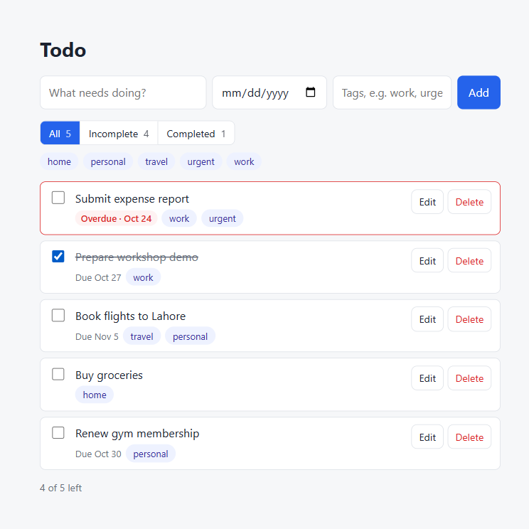

# Todo app

A simple todo list that runs entirely in the browser. Built for [Ticket #3](https://github.com/karachiwaladev/contour-jonas-oct-2026-eng-muneeb-hasan/issues/3), extended in [Ticket #4](https://github.com/karachiwaladev/contour-jonas-oct-2026-eng-muneeb-hasan/issues/4) and [Ticket #5](https://github.com/karachiwaladev/contour-jonas-oct-2026-eng-muneeb-hasan/issues/5).

## Features

- Create, complete and delete tasks
- **Due dates** (optional, date only). Incomplete tasks past their due date are highlighted as **Overdue**; due today is not overdue
- **Tags** (optional, comma-separated). Trimmed, lowercased and de-duplicated, shown as chips
- **Status filter:** All / Incomplete / Completed, with counts
- **Tag filter:** chips for every tag in use, one at a time, combined with the status filter. Clicking a tag on a task applies it
- **Edit** a task's title, due date and tags inline (Enter saves, Escape cancels)
- **Recurring tasks** (Daily / Weekly / Monthly / Yearly). Ticking one done keeps it as a completed task and creates the next occurrence with the same title, tags and repeat:
  - The next date is worked out from the due date and skipped forward to today or later, so an overdue series doesn't create a backlog.
  - Monthly and yearly dates past the end of a shorter month are clamped to its last day, then return to the original day (31 Jan → 28 Feb → 31 Mar).
  - A repeat with no due date starts today. Setting repeat to *Doesn't repeat* stops the series.
- Tasks persist in IndexedDB, and the selected filters persist in `localStorage`



## Run it

ES modules don't load from `file://`, so serve the folder:

```bash
cd todo
python -m http.server 8000
```

Then open http://localhost:8000.

## Files

| File | Purpose |
|---|---|
| `index.html` | Page markup: add form, filter bar, task list |
| `styles.css` | Styles, with light and dark themes |
| `app.js` | UI: rendering, filters, overdue logic, inline editing |
| `db.js` | IndexedDB wrapper (`todo-app` database, `tasks` store) |
| `recurrence.js` | Pure date maths for repeats: `nextDueDate(dueDate, repeat, today, anchorDay)` |
| `test.html` | Browser test: open http://localhost:8000/test.html. It **wipes the `todo-app` database and saved filters**, drives the UI and prints PASS/FAIL per check |
| `screenshots/` | Screenshots from the in-browser check of each ticket |

## Data model

Each task is `{ id, title, done, createdAt, dueDate, tags, repeat, repeatDay, spawned }`:
- `id` is auto-incremented by IndexedDB, and tasks are listed oldest first by `createdAt`.
- `dueDate` is `"YYYY-MM-DD"` or `null`.
- `tags` is an array of lowercase strings.
- `repeat` is `"none" | "daily" | "weekly" | "monthly" | "yearly"`.
- `repeatDay` is the day of month the series is anchored to.
- `spawned` is set once an occurrence has created its next copy, so re-ticking it doesn't create a duplicate.

Tasks saved before #4/#5 lack the newer fields, and are read as `dueDate: null`, `tags: []`, `repeat: "none"`.

The filters are saved under `localStorage["todo-filters"]` as `{ status, tag }`. A saved tag that no longer exists is reset.
